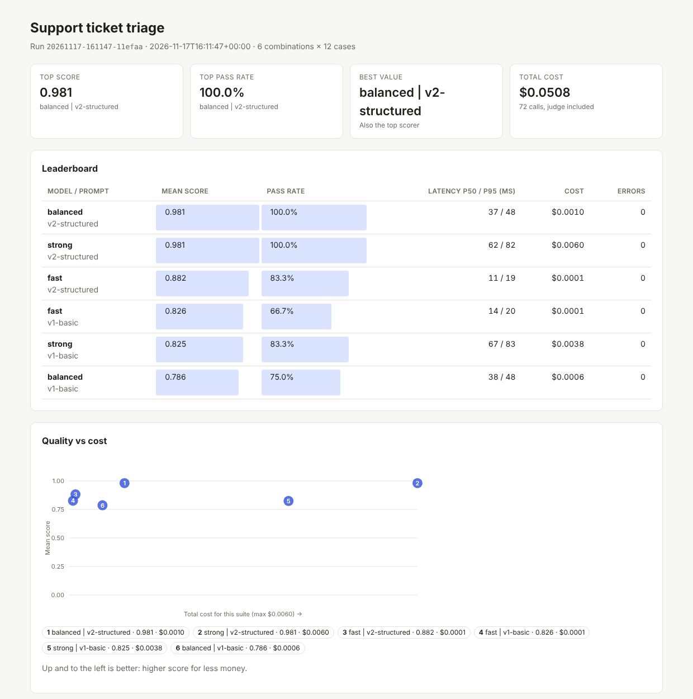

# EvalForge

**Test LLM prompts and models the way you test code.** EvalForge runs a suite of test cases against several models and prompt versions, scores every output, shows the results on a dashboard, and fails your CI build when a change makes quality drop.



## Why

Changing a prompt or switching models can quietly break things that used to work. Most teams find out from users. EvalForge answers three questions before you ship:

1. **Which model and prompt is best** for this task, counting quality, latency and cost?
2. **Did my change make anything worse?** Compare any two runs and see exactly which cases started failing.
3. **Can I trust the LLM judge?** Measure how well the automatic grader agrees with human labels.

## Features

- **Multi-provider runner:** OpenAI (and any OpenAI-compatible API), Anthropic, local models through Ollama, and built-in mock models so everything runs with no API keys. Calls run in parallel, with retries and exponential backoff on rate limits.
- **8 check types:** exact match, contains, not contains, regex, JSON schema validation, word limit, similarity to a reference answer, and LLM-as-judge with a rubric.
- **Tracking:** every run is stored in SQLite with outputs, scores, latency, token counts, cost and git commit.
- **HTML dashboard:** a leaderboard, a quality vs cost chart, scores by tag, a baseline comparison, and a searchable case explorer. It's one self-contained file you can open anywhere.
- **CI regression gate:** a GitHub Action that runs the suite on every pull request and fails if any model/prompt's mean score drops more than a set threshold below the committed baseline.
- **Judge calibration:** Cohen's kappa (quadratic weighted for 1–5 ratings), exact and within-one agreement, plus a list of the biggest disagreements, so you know where to fix the rubric.
- **Small footprint:** the only dependency is PyYAML. HTTP calls use the standard library.

## Quick start

```bash
git clone https://github.com/<you>/evalforge && cd evalforge
pip install -e ".[dev]"

evalforge run suites/support_summaries.yaml --report report.html
open report.html        # on Windows: start report.html
```

```
Model | prompt                             Score    Pass   p50 ms       Cost  Err
---------------------------------------------------------------------------------
balanced | v2-structured                   0.981  100.0%       37    $0.0010    0
strong | v2-structured                     0.981  100.0%       62    $0.0060    0
fast | v2-structured                       0.882   83.3%       11    $0.0001    0
fast | v1-basic                            0.826   66.7%       14    $0.0001    0
strong | v1-basic                          0.825   83.3%       67    $0.0038    0
balanced | v1-basic                        0.786   75.0%       38    $0.0006    0
```

In this example, the structured prompt (`v2`) improves every model, and the mid-priced model with `v2` matches the most expensive one at about one-sixth of the cost.

### Use real models

Uncomment the providers in `suites/support_summaries.yaml`, then:

```bash
export OPENAI_API_KEY=...        # and/or ANTHROPIC_API_KEY
evalforge run suites/support_summaries.yaml --report report.html
```

To use a free local model, install [Ollama](https://ollama.com), run `ollama pull llama3.1:8b`, and add a provider with `provider: ollama`. Set `cost_per_1m` for each real provider using current prices so the cost columns are accurate.

## Catch a regression

```bash
# 1. Save today's results as the baseline and commit the JSON file
evalforge run suites/support_summaries.yaml --save-baseline baselines/support_summaries.json

# 2. Make a change. For example, delete the `system:` block from the v2-structured prompt.

# 3. Compare against the baseline
evalforge run suites/support_summaries.yaml --baseline baselines/support_summaries.json --report report.html
```

```
  strong | v2-structured                   0.981 -> 0.904 (-0.076) regressed
  balanced | v2-structured                 0.981 -> 0.882 (-0.099) regressed
  newly failing: double-charge [balanced | v2-structured]
  newly failing: security-concern [balanced | v2-structured]
Regression gate: FAIL                       # exit code 1, so CI fails
```

`.github/workflows/evals.yml` does this on every pull request and uploads the dashboard as a build artifact.

## Calibrate the judge

LLM-as-judge is only useful if it agrees with people. Label some outputs yourself (`data/judge_calibration.csv` has 24 examples), then run:

```bash
evalforge calibrate suites/support_summaries.yaml data/judge_calibration.csv
```

```
  Cohen's kappa (quadratic weighted): 0.477
  Exact agreement:                    33.3%
  Within 1 point:                     58.3%
  10 large disagreements (2+ points). Review these to refine the rubric:
    t1-3: human 1 vs judge 3 ...
```

The mock judge only reaches moderate agreement because it compares words, not meaning. Two JSON answers share many words even when one is wrong. That's the kind of weakness calibration is meant to expose. Swap in a real judge model, refine the rubric, and rerun until kappa is above about 0.7.

## Other commands

```bash
evalforge list                                  # recent runs
evalforge compare <run_a> <run_b>               # compare stored runs (id prefix or "latest")
evalforge report latest -o report.html          # rebuild the dashboard for a stored run
evalforge run SUITE --min-pass-rate 0.8         # fail if any combination passes < 80% of cases
```

## Writing a suite

```yaml
name: My task
providers:
  - {id: gpt, provider: openai, model: gpt-4o-mini, cost_per_1m: {input: 0.15, output: 0.60}}
judge: {id: judge, provider: openai, model: gpt-4o}
prompts:
  - id: v1
    system: "You are a concise assistant."
    template: "Answer the question: {question}"
default_checks:                       # applied to every case
  - {type: llm_judge, rubric: "Correct and concise.", threshold: 4}
cases:
  - id: capital
    tags: [geography]
    vars: {question: "What is the capital of Australia?"}
    expected: "Canberra"
    checks:
      - {type: contains, value: ["Canberra"]}
      - {type: not_contains, value: ["Sydney"]}
      - {type: max_words, value: 20}
```

Each case's score is the average of its check scores (0–1). A case passes only if every check passes.

## Project structure

```
evalforge/
  providers.py    OpenAI, Anthropic, Ollama and mock models; token and cost tracking
  config.py       suite loading, validation and template rendering
  scorers.py      the 8 check types and the LLM judge
  runner.py       parallel execution, retries, aggregation (p50/p95 latency, pass rate)
  storage.py      SQLite run history
  compare.py      baselines and regression detection
  calibration.py  Cohen's kappa and judge agreement
  report.py       self-contained HTML dashboard
  cli.py          command-line interface
suites/           example test suite
data/             human-labelled judge calibration set
tests/            27 pytest tests
```

## Run the tests

```bash
pytest -q
```

## Ideas for next steps

- Use real embedding models for the similarity check
- RAG metrics: context precision/recall and faithfulness to retrieved documents
- A tracing decorator that logs production LLM calls and turns failures into new test cases
- Repeat each case several times to measure output variance and flaky cases

## License

MIT
